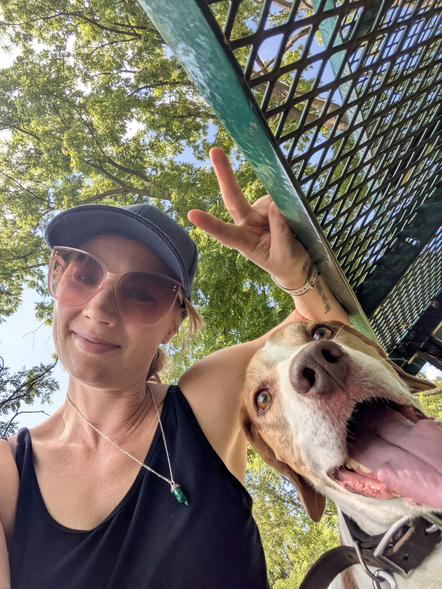

     
  Sveta Bartholomew
  _SVYEH-tah_ /ˈsvjɛtə/ · PhD Student, Information School, UW-Madison

## About

I am a PhD student at the Information School, University of Wisconsin-Madison working in areas of computational linguistics, human-computer interaction, and human-AI interaction. [Jacqueline Brixey](https://ischool.wisc.edu/staff/brixey-jacqueline/) is my advisor.  

## Areas of Interest

- Computational linguistics and natural language processing
- Code-switching
- Language change under the influence of AI
- Ethical and social questions raised by language technologies

## Beyond Research

- 🗣️ **Favorite phrase:** Holy cannoli!
- 🔤 **Favorite word:** *macaronic*, writing that mixes languages
- 📚 **Favorite book:** _The 7½ Deaths of Evelyn Hardcastle_ by Stuart Turton
- 🧘 **Outside the university walls:** yoga, dance, and dark chocolate 🍫

## Links

- [LinkedIn](https://www.linkedin.com/in/svetabartholomew/)
- [GitHub](https://github.com/svetabartholomew)
- [Contact](mailto:sveta.bartholomew@wisc.edu)
